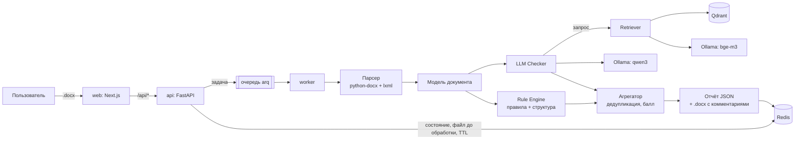

# 000. Обзор архитектуры

Статус: принято (2026-10-25)

## Контекст

Нужно проверять `.docx` по требованиям РК: измеримое (поля, шрифты, интервалы) — точно и
бесплатно, смысловое (оформление записей литературы) — с помощью локальной LLM, которая не
выдумывает требования. Документы содержат персональные данные, команда маленькая.

## Схема

Один код — модульный монолит (`src/normocontrol`), который запускается в двух ролях:
`normocontrol serve` (HTTP) и `normocontrol worker` (обработка очереди). Для разработки
есть режим `jobs.backend: inline` — всё в одном процессе, без Redis.

## Ответы на вопросы задачи A.1

* **Почему оформление — кодом, а не LLM?** LLM не видит форматирования (после извлечения
  текста полей и шрифтов уже нет), плохо сравнивает числа и выдумывает правила. Код точен,
  воспроизводим и бесплатен: на сгенерированном датасете правила дают precision/recall 1.000
  (docs/benchmarks/2026-10-25-rules.md). LLM работает только там, где без понимания текста
  нельзя — запись списка литературы.
* **Почему локальная модель?** Персональные данные (ФИО, ИИН) не должны уходить во внешние
  сервисы; для B2G это обязательное условие. Облачный провайдер подключается тем же
  интерфейсом (`openai_compatible`), если клиент это разрешил.
* **Почему модульный монолит?** Два разработчика, одна предметная область, общая модель
  документа. Микросервисы добавили бы сеть, версии контрактов и деплой без выигрыша.
  Масштабирование уже есть там, где оно нужно: воркеры — отдельные процессы/контейнеры.
* **Узкое место при 100 одновременных пользователях.** LLM: одна модель обслуживает
  ограниченное число параллельных запросов. Детерминированная часть занимает ~1 с на
  документ, LLM-часть — десятки секунд на CPU. Поэтому: очередь с ограничением
  (`jobs.max_pending`, ответ 503 при переполнении), лимит параллелизма на воркер
  (`jobs.max_concurrency`), кэш ответов LLM по хэшу фрагмента, батчинг записей
  (`llm.batch_size`), горизонтальное масштабирование воркеров и vLLM для GPU-сервера.

## Где хранится состояние

| Что | Где | Сколько |
|---|---|---|
| Загруженный файл | Redis (`nc:upload:*`) | до начала обработки, затем удаляется |
| Статус и отчёт | Redis (`nc:check:*`) | `jobs.result_ttl_s` (1 час) |
| `.docx` с комментариями | Redis (`nc:annotated:*`) | столько же, только по запросу |
| Тексты стандартов | `data/standards/` | постоянно, не в git |
| Векторы | Qdrant | постоянно |

Базы данных с пользователями нет — она появится на этапе 6 (аккаунты).

## Последствия

* Новое правило — одна функция с декоратором `@rule`, без правок движка.
* Новый вуз — один YAML-профиль (`extends` от базового).
* Отчёт и ссылка на него живут час; ссылка с непредсказуемым id — единственный «ключ».
